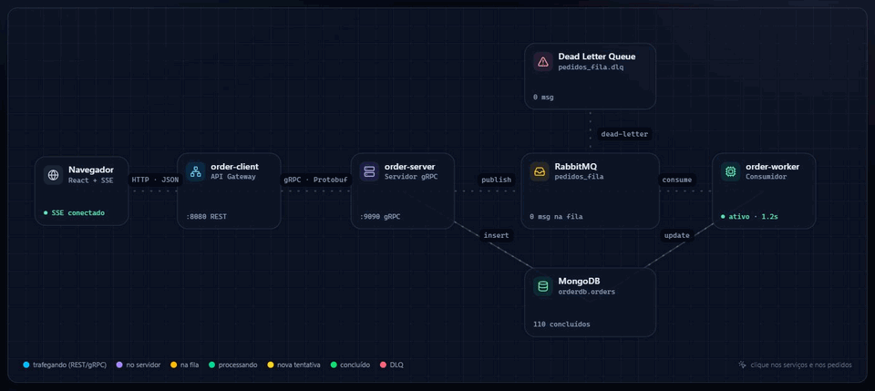
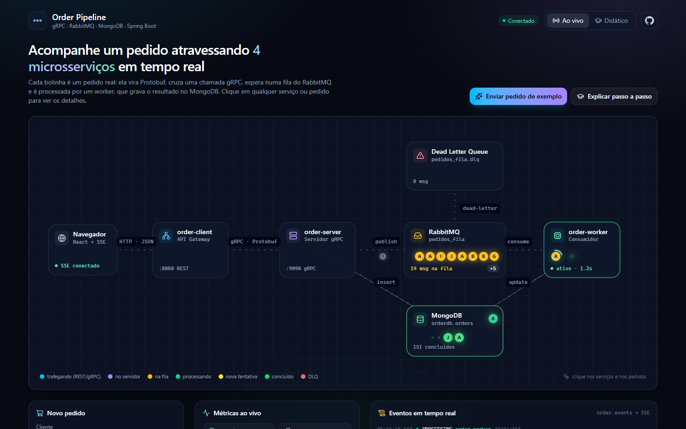
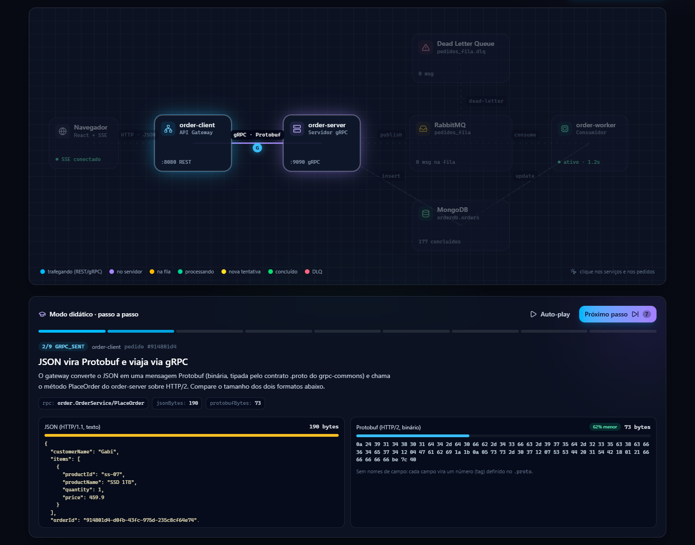
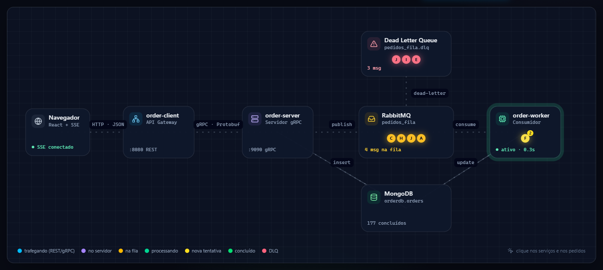
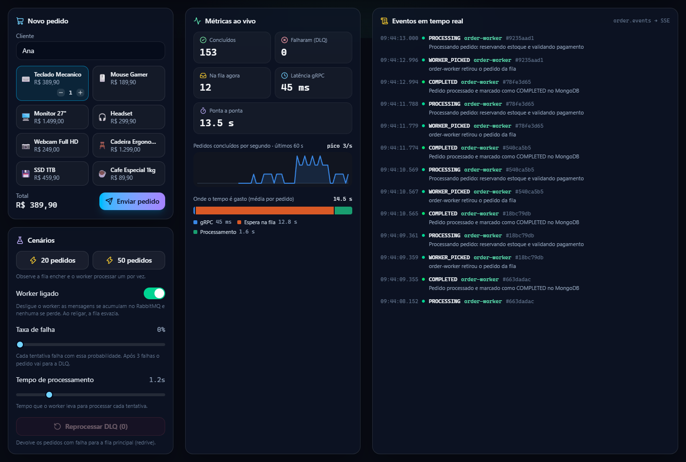
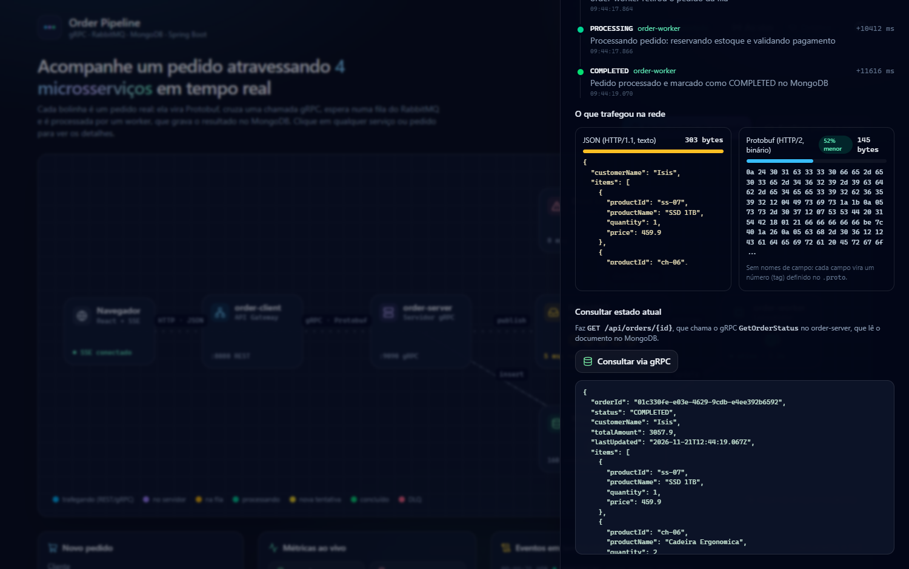
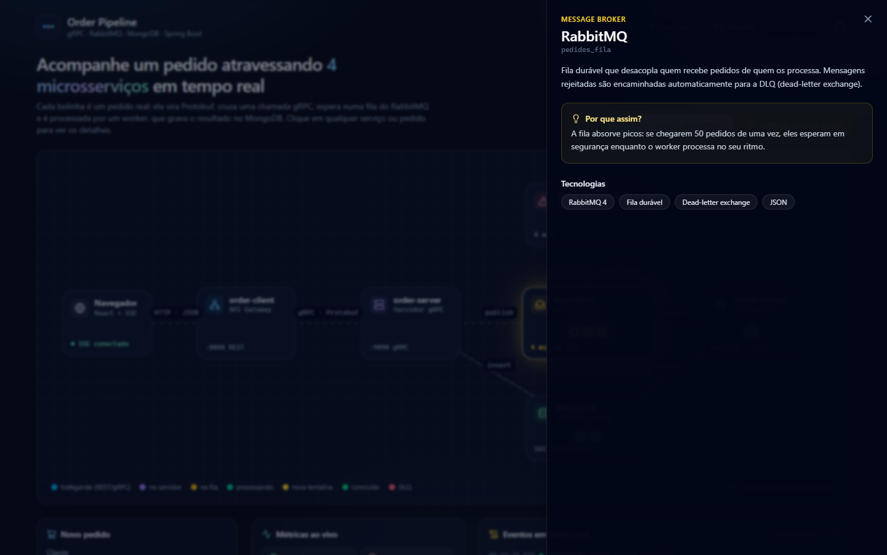
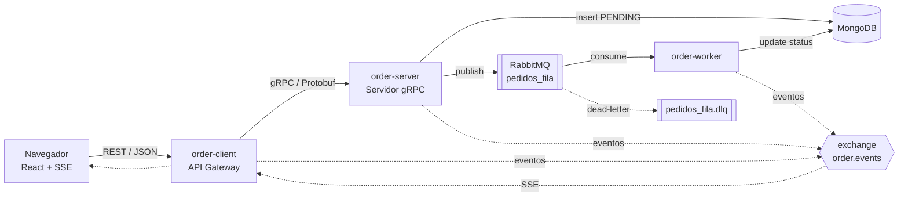
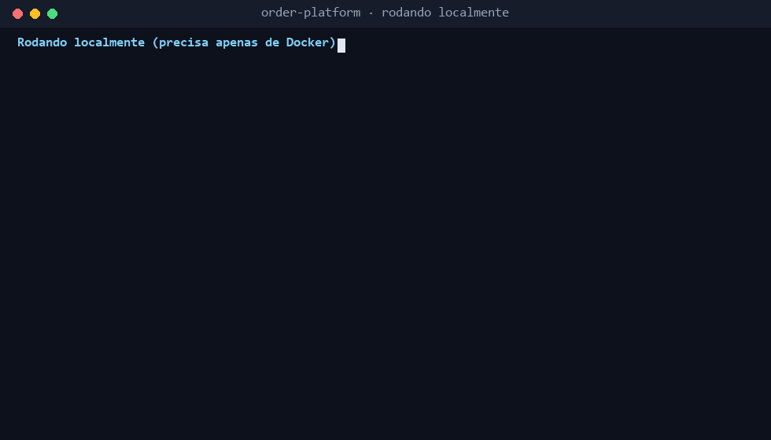
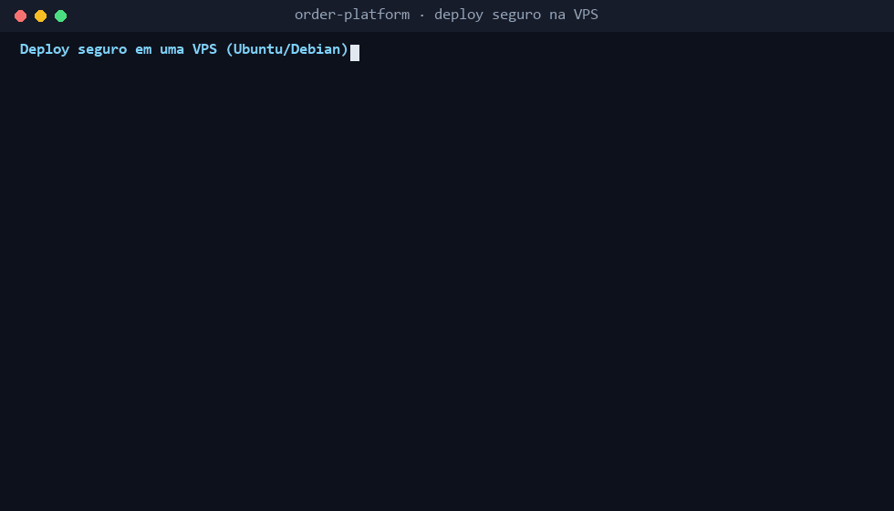

# Order Pipeline · gRPC + RabbitMQ + MongoDB

Plataforma de pedidos com microsserviços em **Java 21 / Spring Boot 4.2** e um **front-end interativo** que mostra, em tempo real e de forma animada, cada pedido atravessando o sistema: REST → gRPC/Protobuf → MongoDB → RabbitMQ → worker → MongoDB.



<sub>Gravação real da aplicação: 1 pedido, depois uma rajada de 25, o worker desligado (os pedidos se acumulam no RabbitMQ) e religado.</sub>

**Sumário:** [Interface](#o-que-dá-para-fazer-na-interface) · [Prints](#prints) · [Arquitetura](#arquitetura) · [Como rodar](#como-rodar) · [Deploy seguro](SECURITY.md) · [Decisões técnicas](#decisões-técnicas)

## O que dá para fazer na interface

| Cenário | O que observar |
|---|---|
| **Enviar um pedido** | A bolinha sai do navegador, vira Protobuf, cruza a chamada gRPC, entra na fila e é processada |
| **Modo didático** | Cada etapa pausa com uma explicação do que acontece e por quê, incluindo **JSON x Protobuf** com os bytes reais do pedido |
| **Rajada de 50 pedidos** | A fila do RabbitMQ enche e o worker esvazia um por vez (`prefetch = 1`) |
| **Desligar o worker** | As mensagens se acumulam no broker e **nenhuma se perde**. Ao religar, a fila esvazia |
| **Taxa de falha** | Novas tentativas com backoff; após 3 falhas o pedido vai para a **Dead Letter Queue** |
| **Reprocessar DLQ** | _Redrive_: os pedidos com falha voltam para a fila principal |
| **Clicar num pedido** | Linha do tempo com os ms de cada etapa e consulta real via gRPC `GetOrderStatus` |
| **Clicar num serviço** | O papel do serviço, a justificativa de arquitetura e as tecnologias usadas |

## Prints

| Visão geral, com pedidos em andamento | Modo didático: JSON × Protobuf com os bytes reais |
|---|---|
|  |  |
| **Falhas: novas tentativas e Dead Letter Queue** | **Simulador, métricas e eventos em tempo real** |
|  |  |
| **Linha do tempo do pedido + consulta gRPC ao MongoDB** | **Explicação de cada serviço ("por que assim?")** |
|  |  |

## Arquitetura



| Repositório | Papel |
|---|---|
| [`grpc-commons`](https://github.com/MatheusSaleh/grpc-commons) | Contrato `.proto` compartilhado, publicado como biblioteca Maven (JitPack) |
| [`order-client`](https://github.com/MatheusSaleh/order-client) | Gateway REST → gRPC, ponte de eventos RabbitMQ → SSE e endpoints do simulador |
| [`order-server`](https://github.com/MatheusSaleh/order-server) | Servidor gRPC: persiste o pedido e publica na fila |
| [`order-worker`](https://github.com/MatheusSaleh/order-worker) | Consumidor: processa, faz novas tentativas e envia para a DLQ |
| [`order-frontend`](https://github.com/MatheusSaleh/order-frontend) | Visualização animada (React, TypeScript, Motion, Tailwind) |
| **`order-platform`** (este) | Docker Compose que sobe tudo + documentação |

### Ciclo de vida de um pedido (eventos)

| Evento | Serviço | Significado |
|---|---|---|
| `CLIENT_RECEIVED` | order-client | POST /api/orders recebido (JSON) |
| `GRPC_SENT` | order-client | Convertido para Protobuf e enviado (inclui tamanho em bytes dos dois formatos) |
| `SERVER_RECEIVED` | order-server | Chamada gRPC `PlaceOrder` recebida |
| `SAVED_PENDING` | order-server | Documento criado no MongoDB com status `PENDING` |
| `QUEUED` | order-server | Mensagem publicada em `pedidos_fila` |
| `GRPC_RESPONDED` | order-client | Resposta `RECEIVED` (com latência) |
| `WORKER_PICKED` / `PROCESSING` | order-worker | Consumido da fila e em processamento |
| `RETRY` | order-worker | Falha simulada; nova tentativa com backoff |
| `COMPLETED` | order-worker | Status final `COMPLETED` no MongoDB |
| `DEAD_LETTERED` | order-worker | Falhou em todas as tentativas e foi para a DLQ |
| `REQUEUED` | order-client | Devolvido da DLQ para a fila (redrive) |

## Como rodar

Pré-requisito: **Docker** (com Compose v2).



Clone os repositórios lado a lado:

```bash
mkdir GRPC && cd GRPC
for repo in grpc-commons order-client order-server order-worker order-frontend order-platform; do
  git clone https://github.com/MatheusSaleh/$repo.git
done

cd order-platform
./scripts/generate-env.sh      # gera o .env com senhas aleatórias (obrigatório)
docker compose up --build      # http://localhost:3000
```

Por padrão **só o front-end publica porta**, e apenas em `127.0.0.1`. Bancos, broker e serviços internos ficam isolados numa rede interna.

| Modo | Comando |
|---|---|
| Local | `docker compose up --build` → http://localhost:3000 |
| Depuração (expõe RabbitMQ, MongoDB, gRPC e APIs em `127.0.0.1`) | `docker compose -f docker-compose.yml -f docker-compose.dev.yml up --build` |
| **VPS com HTTPS** | `docker compose -f docker-compose.yml -f docker-compose.https.yml up -d --build` |

Para publicar numa VPS, siga o **[guia de segurança e deploy](SECURITY.md)**:



### Testando sem o front-end

```bash
# Criar um pedido (passa pelo nginx do front)
curl -X POST localhost:3000/api/orders -H 'Content-Type: application/json'   -d '{"customerName":"Ana","items":[{"productId":"kb-01","productName":"Teclado","quantity":2,"price":389.9}]}'

# Consultar (REST -> gRPC GetOrderStatus -> MongoDB)
curl localhost:3000/api/orders/<orderId>

# Acompanhar os eventos ao vivo
curl -N localhost:3000/api/events/stream

# gRPC direto via reflection (somente no modo de depuração)
grpcurl -plaintext -d '{"order_id":"<orderId>"}' localhost:9090 order.OrderService/GetOrderStatus
```

No modo de depuração, o painel do RabbitMQ fica em http://localhost:15672 (usuário e senha no `.env`).

## Decisões técnicas

- **gRPC entre serviços, REST na borda.** Protobuf é binário e tipado pelo contrato: o mesmo pedido fica cerca de 50% menor que em JSON e incompatibilidades aparecem em tempo de compilação. Navegadores não falam gRPC nativo, então o `order-client` funciona como gateway.
- **Contrato versionado em repositório próprio.** O `grpc-commons` é publicado como dependência Maven (JitPack, por tag). Mudar o `.proto` significa publicar uma nova versão e atualizar os consumidores, como em empresas com vários times.
- **Persistir antes de enfileirar.** O pedido é salvo como `PENDING` antes de ir para a fila, então nenhum pedido aceito se perde e ele sempre pode ser consultado.
- **Processamento assíncrono com fila.** O servidor responde em milissegundos e a fila absorve picos. Para escalar, basta subir mais réplicas do worker.
- **Resiliência:** novas tentativas com backoff, DLQ via `x-dead-letter-exchange` e redrive com ack manual (a mensagem só sai da DLQ depois de republicada).
- **Observabilidade orientada a eventos.** Cada serviço publica eventos em um exchange `topic`. O gateway assina com uma fila exclusiva e repassa ao navegador por **Server-Sent Events**, que é mais simples que WebSocket para um fluxo de mão única.
- **Java 21:** records e virtual threads (para disparar rajadas de pedidos sem bloquear requisições).
- **Seguro por padrão:** nada interno exposto, senhas obrigatórias, usuário de banco com privilégio mínimo, containers sem root e somente leitura, rate limit, CSP e scan de CVEs no CI. Detalhes em [SECURITY.md](SECURITY.md).

## Stack

**Backend:** Java 21 · Spring Boot 4.2 (starters gRPC oficiais) · gRPC 1.84 · Protobuf 4.36 · Spring AMQP 4 · Spring Data MongoDB · Jackson 3 · Actuator
**Infra:** RabbitMQ 4 · MongoDB 8 · nginx · Caddy (HTTPS) · Docker multi-stage · Docker Compose · GitHub Actions · Trivy · Dependabot
**Front-end:** React 19 · TypeScript · Vite · Tailwind CSS 4 · Motion · Zustand

## Próximos passos

- [ ] Testes de integração com Testcontainers (RabbitMQ + MongoDB reais)
- [ ] Publicar as imagens no GitHub Container Registry
- [ ] Rastreamento distribuído com OpenTelemetry + Jaeger
- [ ] Demo online
