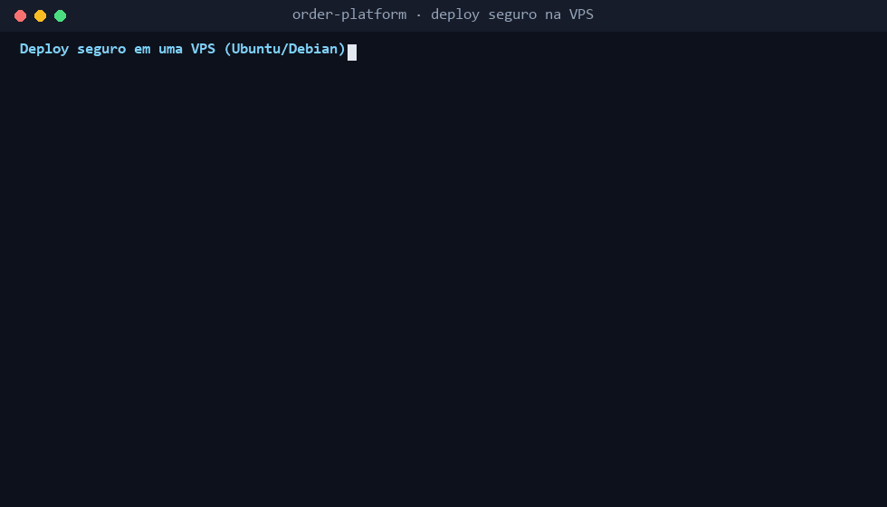

# Segurança e deploy em VPS

Este documento descreve as proteções da plataforma e o passo a passo para publicá-la numa VPS sem abrir brechas no servidor.

## Resumo das proteções

| Camada | Proteção |
|---|---|
| **Rede** | Só o Caddy (HTTPS) ou o front-end publica porta. MongoDB, RabbitMQ, gRPC e as APIs internas **não** são expostos no host |
| **Rede** | A rede `backend` é `internal`: os containers internos não acessam a internet (dificulta exfiltração se algum for comprometido) |
| **Credenciais** | Sem senhas padrão: o compose não sobe sem `.env`. O script `generate-env.sh` gera senhas aleatórias e o `.env` nunca é versionado |
| **Banco** | As aplicações usam um usuário MongoDB com `readWrite` apenas no `orderdb`. O root fica só para administração |
| **Containers** | Processos sem root, `no-new-privileges`, `cap_drop: ALL`, sistema de arquivos somente leitura, limite de memória e rotação de logs |
| **HTTP** | HTTPS automático (Let's Encrypt) com HSTS, CSP restritiva, `X-Frame-Options`, `nosniff`, `Referrer-Policy`, `Permissions-Policy` e versão do servidor oculta |
| **Abuso** | Rate limit por IP no nginx, no máximo 4 conexões SSE por IP, corpo limitado a 16 KB, rajadas limitadas a 50 pedidos, teto global de pedidos simulados em andamento e teto de conexões SSE |
| **Demo pública** | Se alguém desligar o worker ou colocar 100% de falha, a configuração volta ao padrão sozinha em 3 minutos. `SIMULATION_ENABLED=false` remove os endpoints do simulador |
| **Entrada** | Validação no gateway **e** no servidor gRPC: tamanhos, intervalos e caracteres permitidos (evita documentos gigantes e injeção em logs) |
| **Integridade** | Pedidos são gravados com `insert`: um `orderId` repetido retorna 409 e nunca sobrescreve outro pedido |
| **CORS** | Requisições de escrita vindas de outros sites são recusadas (403) |
| **gRPC** | Reflection desligado por padrão. O gRPC só é alcançável pela rede interna |
| **Dependências** | Spring Boot 4.2, gRPC 1.84, nginx 1.30.7, imagens com `apk upgrade`. Dependabot semanal e Trivy no CI (o build falha com CVE HIGH/CRITICAL corrigível) |

Último scan local com Trivy: **0 vulnerabilidades** (qualquer severidade) nas imagens `order-server`, `order-client`, `order-worker` e `frontend`.

## Deploy numa VPS (Ubuntu/Debian)



### 1. Prepare o servidor

```bash
# Atualizações automáticas de segurança do sistema
sudo apt update && sudo apt upgrade -y
sudo apt install -y unattended-upgrades fail2ban
sudo dpkg-reconfigure -plow unattended-upgrades

# Firewall: apenas SSH, HTTP e HTTPS
sudo ufw default deny incoming
sudo ufw allow OpenSSH
sudo ufw allow 80/tcp
sudo ufw allow 443
sudo ufw enable
```

No SSH (`/etc/ssh/sshd_config`), use login por chave e desative senha e root:

```
PasswordAuthentication no
PermitRootLogin no
```

> ⚠️ **Importante:** o Docker cria regras de iptables próprias e **ignora o UFW** para portas publicadas com `ports:`. Por isso este projeto não publica nenhuma porta interna. Nunca use o `docker-compose.dev.yml` na VPS.

### 2. Instale o Docker e clone os repositórios

```bash
curl -fsSL https://get.docker.com | sudo sh
sudo usermod -aG docker $USER   # saia e entre de novo na sessão

mkdir -p ~/GRPC && cd ~/GRPC
for repo in grpc-commons order-client order-server order-worker order-frontend order-platform; do
  git clone https://github.com/MatheusSaleh/$repo.git
done
cd order-platform
```

### 3. Gere as senhas e configure o domínio

```bash
./scripts/generate-env.sh
nano .env    # preencha DOMAIN=seu-dominio.com
```

Aponte o DNS do domínio (registro A/AAAA) para o IP da VPS antes de subir.

### 4. Suba com HTTPS

```bash
docker compose -f docker-compose.yml -f docker-compose.https.yml up -d --build
```

O Caddy obtém e renova o certificado sozinho. Confira com `docker compose ps`: só o `caddy` deve mostrar portas (80/443).

### 5. Confira o que está exposto

De **outro computador**:

```bash
nmap -Pn seu-dominio.com          # esperado: apenas 22, 80 e 443
curl -I https://seu-dominio.com   # cabeçalhos strict-transport-security, content-security-policy...
```

## Manutenção

```bash
cd ~/GRPC && for d in */; do git -C "$d" pull; done
cd order-platform
docker compose -f docker-compose.yml -f docker-compose.https.yml up -d --build --pull always
docker image prune -f
```

Rode isso pelo menos uma vez por mês, ou quando o Dependabot abrir PRs de segurança, para receber correções das imagens base.

### Acessar o painel do RabbitMQ ou o MongoDB na VPS

Não publique as portas. Use um túnel SSH, que só funciona para quem tem a chave do servidor:

```bash
# No servidor: descubra o IP interno do container
docker inspect -f '{{range .NetworkSettings.Networks}}{{.IPAddress}} {{end}}' order-platform-rabbitmq-1

# No seu computador: http://localhost:15672
ssh -L 15672:<ip-do-container>:15672 usuario@seu-servidor
```

## Riscos aceitos (demo pública)

- **Os dados dos pedidos são públicos:** o fluxo de eventos (SSE) mostra a todos os visitantes os pedidos de todo mundo, incluindo o nome do cliente. É o objetivo da demo. A interface não deve ser usada com dados reais.
- **Sem autenticação:** qualquer visitante pode criar pedidos e usar o simulador. Os limites acima contêm o abuso, e `SIMULATION_ENABLED=false` desliga o simulador.
- **Tráfego interno sem TLS:** gRPC, AMQP e MongoDB trafegam sem criptografia, mas só dentro da rede Docker isolada da própria VPS.
- **Os volumes crescem com o uso.** Para limpar os pedidos de teste: `docker compose down -v` (apaga os dados).

## Reportando vulnerabilidades

Encontrou um problema de segurança? Abra uma issue privada (Security Advisory) no repositório em vez de uma issue pública.
